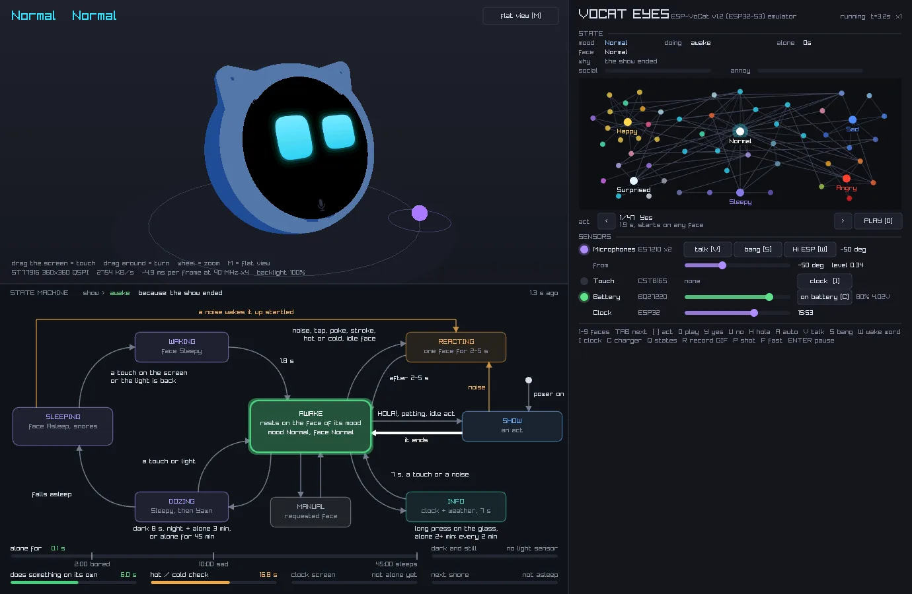

# Cute Desktop Robot

Small desk robots with a face, built on off-the-shelf boards and written in plain C++.
Each robot runs the same code on the hardware, in a desktop emulator and in the browser.

| Robot | Board | What it does |
|-------|-------|--------------|
| [**VoCat Eyes**](vocat-eyes/) | Espressif ESP-VoCat v1.2 (ESP32-S3, 360×360 round touch screen, 2 mics, speaker) | 56 expressions, 47 animations, eyes that follow your voice, spoken conversation through Gemini Live, Wi-Fi and settings on the screen |

More robots will join this repository.

Read how VoCat Eyes works, and play with it in your browser, on the
[Velxio blog](https://velxio.dev/blog/posts/cute-desktop-robot-vocat-eyes).

## License

Code: MIT, see [LICENSE](LICENSE). The 3D enclosure model in `vocat-eyes/assets/3d/` comes from
Espressif (ESP-College on OSHWHub) and stays under GPL-3.0.
