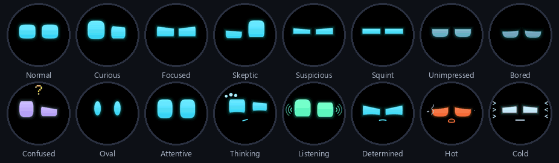
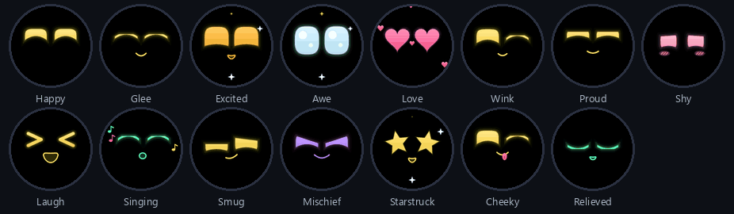
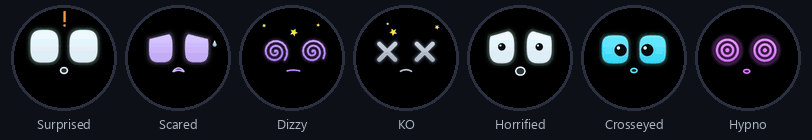
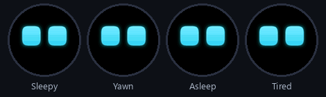
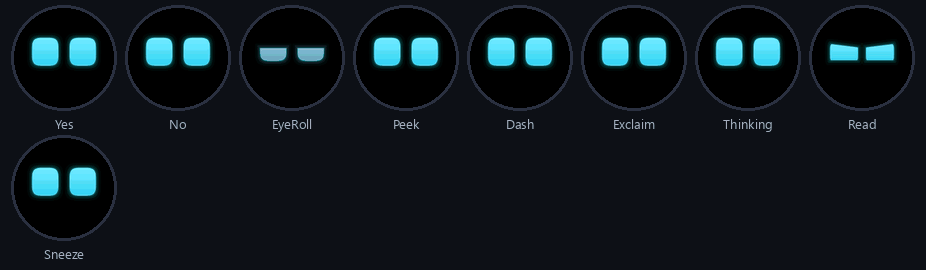
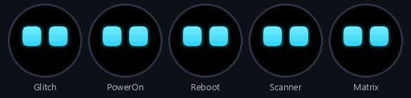
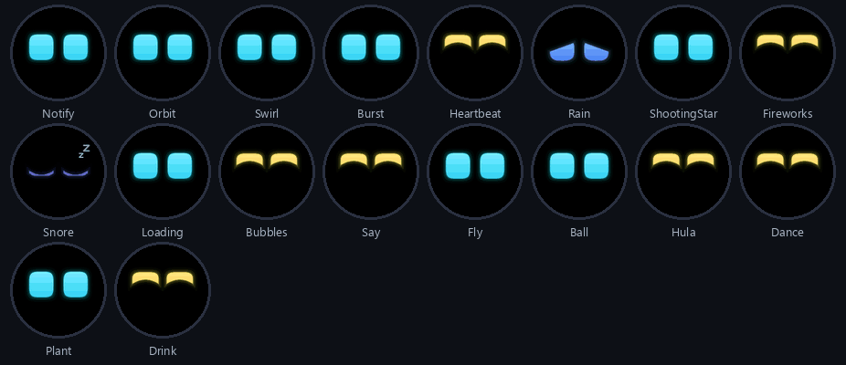
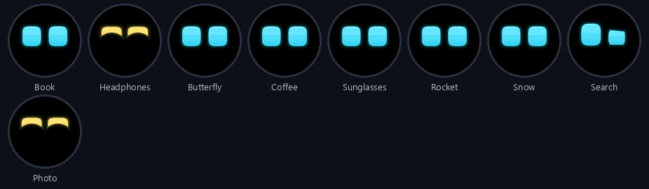
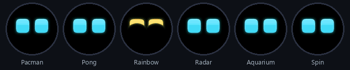

# VoCat Eyes

Robot de escritorio con cara en la placa **Espressif ESP-VoCat v1.2** (ESP32-S3, pantalla
redonda táctil de 360 px, dos micrófonos, altavoz, IMU y batería). Es el motor de cara de
`xiao-round-eyes` llevado a esta placa, más lo que ella permite: oír de dónde le hablan y
(más adelante) hablar con una voz de Gemini.

## Estado

| Fase | Qué | Estado |
|------|-----|--------|
| 1 | Cara en la pantalla, táctil, batería, reloj, emulador | hecho |
| 2 | Micrófonos: palabra de activación "Hi ESP", dirección de la voz, altavoz (chirridos) | hecho, por afinar |
| 3 | Conversación con Gemini Live (Wi-Fi) | conecta y saluda; el micrófono no llegaba a Gemini (arreglado 27-10, falta probar) |
| 4 | Wi-Fi desde la pantalla (lista de redes + teclado), icono de micrófono, toque = animaciones | hecho |

## Carpetas

- `vocat-eyes.ino`, `Config.h`: sketch y mapa de pines.
- `src/core`, `src/face`: motor de cara (igual que xiao-round-eyes, a 360 px).
- `src/hw`: pantalla (`VocatLcd`), táctil, batería (`BQ27220`), reloj.
- `src/brain`: sensores, cerebro, pantalla de reloj y batería.
- `src/audio`: códecs ES8311/ES7210, bus I2S (TDM de 4 ranuras en ambos sentidos), `Player`
  (cola de sonido en PSRAM y chirridos), `Listener` (nivel, voz, golpes y dirección de la voz
  por el retardo entre micrófonos), `WakeWord` ("Hi ESP" con ESP-SR).
- `src/voice`: `GeminiLive` (WebSocket con Gemini Live: micrófono arriba, voz abajo, herramientas)
  y `Talk` (cuándo empieza la conversación, qué cara pone, qué cambian las herramientas).
- `emulator/`: versión Windows (raylib). `mingw32-make` dentro de la carpeta y `robot_emu.exe`.
- `firmware_backup/`: volcado completo del firmware original de fábrica (no se sube al git).
- `secrets.h`: Wi-Fi y clave de Gemini. No se sube al git.

## Todas las expresiones y animaciones

Generadas por `facetool` con el mismo motor que el firmware.

### 56 expresiones, por estado de ánimo

**Tranquilo y pensando** (16)



**Feliz** (15)



**Triste** (8)


**Enfadado** (6)


**Sorpresa y alerta** (7)



**Sueño** (4)



### 47 animaciones, por familia

**Gestos** (9)



**Efectos de pantalla** (5)



**Con objetos** (18)



**Cosas cotidianas** (9)



**Juegos y efectos del cristal redondo** (6)



## Compilar y grabar

```
arduino-cli --config-file tools/arduino-cli.yaml compile ^
  --fqbn "esp32:esp32:esp32s3:PSRAM=opi,FlashSize=16M,PartitionScheme=esp_sr_16,USBMode=hwcdc,CDCOnBoot=cdc,FlashMode=qio" ^
  --build-property upload.maximum_size=6291456 --build-path build .
arduino-cli --config-file tools/arduino-cli.yaml upload -p COM5 --fqbn "<el mismo>" --input-dir build .
```

Si al grabar pide `srmodels.bin`, copiarlo a `build/` desde
`..\.arduino15-esp32v3\packages\esp32\tools\esp32s3-libs\3.3.12\esp_sr\`.

`partitions.csv` (en la carpeta del sketch) da 6 MB a la aplicación sin OTA: ESP-SR no cabe
en la tabla de serie. El `--build-property` de arriba es para que el compilador lo sepa.

## Tocar la pantalla

- **Toque**: reproduce la siguiente animación (van en orden).
- **Toque sobre el micrófono** (icono pequeño abajo): empieza o termina la conversación.
  Gris = apagado, azul parpadeando = conectando, cian = escucha, naranja = habla.
- **Pulsación larga**: pantalla de reloj y batería. Un toque ahí abre los ajustes.

## Ajustes

Pulsación larga → reloj → toque. Dos páginas (`1/2 >` pasa de página). En cada fila, tocar la
mitad izquierda baja o va al anterior, y la derecha sube o va al siguiente:

| Ajuste | Valores |
|--------|---------|
| Volumen | 0-100 % de 10 en 10 (suena un pitido con el nivel nuevo) |
| Brillo | 20-100 % |
| Voz | voz de Gemini: Puck, Charon, Kore, Fenrir, Aoede, Leda, Orus, Zephyr (vale desde la próxima charla) |
| Wi-Fi | abre la lista de redes y el teclado |
| Hi ESP | palabra de activación sí/no (apagada libera ~100 KB de RAM) |
| Sonidos | pitidos de la cara sí/no |
| Autonomo | si mira, juega y duerme por su cuenta |
| Fin charla | segundos de silencio que terminan la conversación: 10, 20, 30, 60 |

Pulsación larga o 30 s sin tocar cierran y guardan en la flash (NVS, espacio `cfg`).
`vol N` en la consola también guarda.
- **Caricia** (mover el dedo): mimos.

## Wi-Fi desde la pantalla

Pulsación larga → reloj → toque → Wi-Fi. Sale la lista de redes (por señal, 5 por página, `n/m >`
pasa de página, `buscar` repite el escaneo). Toca la tuya y escribe la contraseña:
`^` mayúsculas, `#` números y símbolos (dos páginas), `<` borra, `OK` conecta. Una red
abierta conecta al tocarla. Pulsación larga sale. La red se guarda en la flash (NVS) y manda
sobre `secrets.h`. Solo redes de 2.4 GHz: el ESP32-S3 no tiene radio de 5 GHz.

Desde la consola: `wifi set <ssid> <contraseña>` hace lo mismo sin teclear en el cristal.

El escaneo lo hace la tarea de red: si estaba intentando conectarse a otra red, para un
momento, escanea (reintenta 3 veces) y vuelve a intentar. Si la conexión falla, la reintenta
cada 15 s. La pantalla de reloj enseña el estado: "wifi ok" en verde, o el motivo en naranja
("clave erronea", "no veo la red", "conectando").
`scan` en la consola lista las redes con señal, canal, seguridad y BSSID.

Ojo: la red guardada desde la pantalla manda sobre `secrets.h`. Con el router de casa
(WPA/WPA2 mixto) una clave mal escrita da el código 210 ("seguridad no compatible") en vez
de "clave incorrecta"; el robot lo muestra como "clave erronea".

## Hablar con el robot

1. Pon la red (desde la pantalla, con `wifi set`, o en `secrets.h`) y la clave de Gemini en `secrets.h`.
2. Di **"Hi ESP"**, toca el icono del micrófono, un pad de la carcasa, o escribe `talk` en la consola.
3. La cara pasa a "escuchando"; habla normal. Mientras responde no escucha (así no se oye
   a sí mismo); la conversación termina sola tras 20 s de silencio o tocando un pad.
   Gemini puede cambiar la cara (`set_face`), hacer gestos (`play_act`), mirar (`look`) y
   mostrar un texto corto (`show_text`). Ajustes en `Config.h`: modelo, voz, idioma, nombre.

Si los ojos giran hacia el lado contrario del que habla, intercambia `MIC_SLOT_RIGHT` y
`MIC_SLOT_LEFT` en `Config.h`.

La clave de Gemini tiene que ser de un proyecto con saldo (o con nivel gratuito activo): si no,
Gemini cierra la sesión nada más abrirla y el robot lo dice en la consola
(`talk: failed: Gemini: Your prepayment credits are depleted...`). Se gestiona en
https://ai.studio/projects.

Memoria: ESP-SR (palabra de activación) se queda ~100 KB de RAM interna y la conexión TLS a
Gemini necesita ~45 KB, así que al empezar una conversación se para ESP-SR (`sr_stop`) y al
acabarla se vuelve a cargar (tarda ~1,2 s; mientras, la cara no se mueve). `mem` lo enseña.
El cliente WebSocket (ArduinoWebsockets) no sabe hacer `setInsecure` en ESP32, por eso lleva
los certificados raíz de Google en `src/voice/google_roots.h` (válidos hasta 2036).

## Consola serie (115200)

`list`, `<cara>`, `act <nombre>`, `say <texto>`, `info`, `time HH:MM`, `status`, `auto on|off`,
`talk`, `stop`, `vol <0-100>`, `chirp <n>`, `mics` (nivel de cada ranura de micrófono),
`wifi`, `wifi set <ssid> <contraseña>`, `wifi setup` (abre el ajuste en la pantalla), `mem`
(RAM interna y PSRAM libres; durante una charla la consola escribe `you: ...` con lo que Gemini entendió), `net` (prueba DNS, TLS y el saludo WebSocket con Gemini paso a
paso), y para probar sin micrófonos: `voice <grados>`, `noise`, `wake`.

Si el monitor serie está abierto (PuTTY), la grabación falla con "COM5 busy": ciérralo antes.

## Volver al firmware original

```
esptool --chip esp32s3 -p COM5 write-flash 0x0 firmware_backup\vocat_flash_16MB_20261022.bin
```
